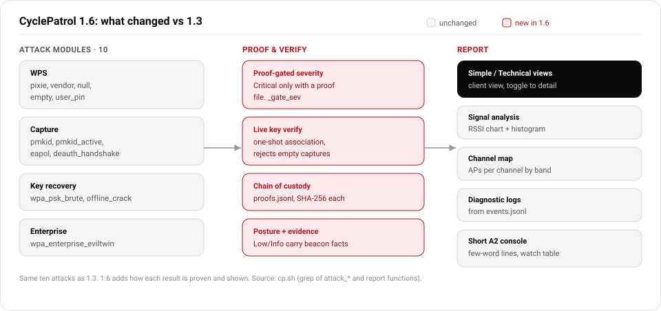

# CyclePatrol 1.6: main features vs 1.3

The ten attack modules are the same in both versions. 1.6 adds the layer around them: how a result is
proven and verified, and what the report shows.

## Attacks

Same ten modules in 1.3 and 1.6. No attack type was added or removed.

| Group | Modules | What it does |
|---|---|---|
| WPS | `attack_pixie`, `attack_vendor`, `attack_null`, `attack_empty`, `attack_user_pin` | WPS PIN recovery: Pixie Dust, vendor and default PINs, null and empty PIN, operator PIN |
| Capture | `attack_pmkid`, `attack_pmkid_active`, `eapol_passive_capture`, `attack_deauth_handshake` | PMKID (passive and active), passive EAPOL, deauth-assisted 4-way handshake |
| Key recovery | `attack_wpa_psk_brute`, `offline_crack` | online WPA2-PSK dictionary, and offline crack of a capture (hashcat 22000 / aircrack) |
| Enterprise | `attack_wpa_enterprise_eviltwin` | 802.1X evil-twin credential capture (eaphammer / hostapd-wpe) |

### New in 1.6: how a result becomes a finding

| Feature | What it does | Source |
|---|---|---|
| Proof-gated severity | A finding is Critical only when a key was recovered and a proof file exists. Posture notes stay Low or Info. | `_gate_sev`, `_count_sev` |
| Live key verification | Confirms a recovered key with a one-shot association and rejects empty captures. | `verify_psk_live_proofed`, `_pcap_has_packets` |
| Chain of custody | Every proof file is recorded in a `proofs.jsonl` manifest with its SHA-256. | `_proofs_manifest_add` |
| Posture with evidence | Low and Info findings are built from the scan and carry the measured beacon facts that back each rating. | `build_posture_findings`, `posture_scan_targets`, `_essid_default_scheme` |

## Reports

The 1.3 report had 10 sections. 1.6 keeps them and adds the following.

| Feature | What it does | Source |
|---|---|---|
| Simple and Technical views | The report opens in a Simple view for the client and toggles to a Technical view that adds posture findings, the evidence table, and the diagnostic log. | `_report_view_toggle` |
| Signal analysis | Per-network RSSI chart and a signal-strength histogram. | `_report_signal_chart`, `_report_signal_hist` |
| Channel map | Access points per channel, colored by band. | `_report_channel_chart` |
| Diagnostic logs | A log section built from the structured event log. | `_report_diag_logs`, `events.jsonl` |
| Short console output | Attack and result lines in a few plain words, plus a live per-scan watch table. | `print_run_summary`, `render_watch_table` |

Channel map and Signal analysis render after the asset table. Diagnostic logs render before the final
recommendations. The last three appear in the Technical view.

