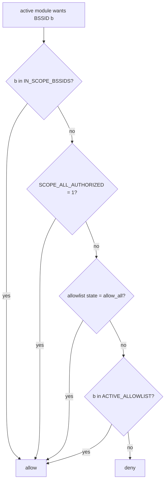

# Security model and observations

This page describes how CyclePatrol decides what it may attack, where it stores recovered secrets,
and the facts a reviewer should know before running it. Everything here is read from `cp.sh`. It is
for understanding and safe operation, not an exploitation guide.

CyclePatrol runs active wireless attacks as root. Run it only on networks you own or have written
permission to test.

## Authorization and scope

Only the active modules ask the scope gate before they run. The WPS PIN chain, passive PMKID, and
passive EAPOL capture do not call it (see [`modules.md`](modules.md)). The gate is
`active_attack_permitted`:

### Default posture is open ⚠️

Two defaults make the gate allow every scanned AP in a default run:

1. `SCOPE_ALL_AUTHORIZED` defaults to `1`. The gate returns allow on that alone.
2. `process_target` adds every scanned BSSID to `IN_SCOPE_BSSIDS` before the modules run, so the
   first check is already true for any AP the scanner saw.

So out of the box the active modules will run against any AP in range (subject to the per-module
enable flags and `RSSI_ATTACK_MIN`). To constrain scope to networks you are authorized to test, set:

- `SCOPE_ALL_AUTHORIZED=0`, and
- an allowlist: `ACTIVE_BSSID_ALLOWLIST` (CSV) or `ACTIVE_ALLOWLIST_FILE` (one BSSID per line), and
- for the enterprise evil-twin module, an ESSID allowlist (`EVILTWIN_ESSID_ALLOWLIST` / `_FILE`),
  which is required for that module to run at all.

Keep the active capture and attack flags off (`ENABLE_PMKID_ACTIVE`, `ENABLE_DEAUTH`,
`ENABLE_DEAUTH_BROADCAST`, `ENABLE_WPA_BRUTE`, `ENABLE_EVILTWIN`) unless the engagement calls for
them. Broadcast deauth is denial-of-service class.

## Recovered secrets on disk

When a key is recovered, `save_proof` writes it to `proof/proof_*.conf`: the WPS PIN, the WPA key,
a SHA-256 of the key, and a `live_verified` marker. The key is on disk in clear text. The SHA-256 is
there so a third party can confirm the proof file was not changed without exposing the key.

- `REVEAL_CREDS` defaults to `1`, so the PIN and PSK are also shown in the report body and the audit
  log by default. Set `REVEAL_CREDS=0` to mask them in the report. The real key still lives in the
  proof file.
- `proof/proofs.jsonl` is a manifest of every proof file with its SHA-256 (see
  [`outputs.md`](outputs.md)). It holds hashes and metadata, not the key.

### File modes are best-effort ⚠️

The log dir is created `chmod 700` and data files `chmod 600`, but the default `LOG_DIR` is
`/sdcard/Download/wifi`. On a FAT/exFAT SD card (common on Android) POSIX modes are not enforced, so
the proof files may be world-readable in practice. Put `LOG_DIR` on a real POSIX filesystem when the
secrets must stay protected.

## External WPA-audit script

`wpa_audit_external_dispatch` runs an operator-supplied script named by `WPA_AUDIT_EXTERNAL_TOOL`
(default path `<repo>/wpa_audit_target.sh`, which is not shipped). It runs only when
`ENABLE_WPA_AUDIT=1` and `WPA_AUDIT_MODE=external`, and only if the file is executable. Because it
executes an external program as root, treat that path as a trust boundary: point it only at a script
you wrote and control.

## Dead code (present, never called)

`sae_dos_dragondrain` (wraps `dragondrain`) and `sae_timing_dragontime` (wraps `dragontime`) are
defined but have no caller. In this build the SAE DoS and SAE-timing checks never run, and the env
vars that only those functions read (`ENABLE_SAE_DOS`, `ENABLE_SAE_TIMING`, `SAE_DOS_SECS`,
`SAE_TIMING_SECS`, `DRAGON_DOS_TOOL`, `DRAGON_TIME_TOOL`) have no runtime effect. The
`active_attack_permitted` calls inside them therefore never execute.

## Input handling

Beacon and probe-response data from the air is attacker-controllable. It is parsed by the `awk`
program in `parse_scan`. Values that reach JSON go through `json_escape` and values that reach HTML
go through `_html_escape`. BSSIDs are normalized and checked (`normalize_bssid`, `check_bssid`)
before use in a shell command. Operator input (interface name, log dir, country code, numeric
ranges, user PIN) is validated in `validate_env`. See
[`architecture.md`](architecture.md#trust-boundaries) for the full boundary diagram.

## Third-party data licensing ⚠️

`vendor/oui.json` and `vendor/vendors.json` are bundled vendor/OUI lookup data, not written for this
project. Confirm their source and license before redistributing them under this repository's MIT
license, and keep any upstream notice they require.

## Observation summary

| ID | Observation | Where |
|---|---|---|
| O1 | Default scope is open (`SCOPE_ALL_AUTHORIZED=1`, every scanned BSSID added to `IN_SCOPE_BSSIDS`) | `active_attack_permitted`, `process_target` |
| O2 | Recovered PIN/PSK stored in clear text in proof files, shown in the report by default (`REVEAL_CREDS=1`) | `save_proof`, `make_report` |
| O3 | File modes are best-effort and not enforced on FAT/exFAT SD cards | `run_precheck`, default `LOG_DIR` |
| O4 | `WPA_AUDIT_EXTERNAL_TOOL` executes an operator-supplied script as root (gated off by default) | `wpa_audit_external_dispatch` |
| O5 | Several active flags default to on at the top of the file, keep them off outside an engagement | top-of-file `:=` defaults |
| O6 | SAE DoS / timing functions are dead code and never run | `sae_dos_dragondrain`, `sae_timing_dragontime` |
| O7 | Bundled vendor data needs a license check before redistribution | `vendor/*.json` |
